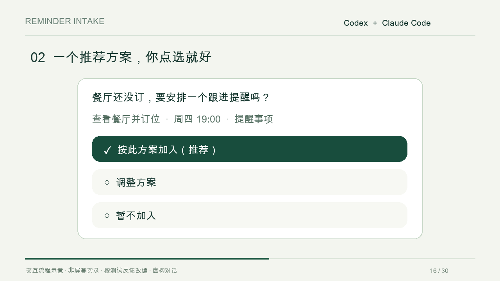

# Reminder Intake · 聊完别忘

[English](README.md) · [简体中文](README.zh-CN.md)

**聊完了，下一步别丢。**



[观看 30 秒动效演示](https://github.com/dryan3333/reminder-intake-skill/releases/download/v0.3.0/reminder-intake-demo-v2.mp4)（交互示意，非屏幕实录）。

A reusable Codex and Claude Code skill that notices actionable dates and unfinished follow-ups, then asks whether to add them to Apple Calendar, Google Calendar, or macOS Reminders.

一个可公开复用的 Codex / Claude Code 技能：识别对话中的截止日期、预约、后续任务和明确暂停的工作，适时询问是否加入日历或提醒事项。

## 能做什么

- 从对话提取事项、日期、通知时间、时区和重复规则。
- 同一计划讨论满三轮时默认提议一次；明确提醒请求立即处理，已提议的不循环催问。
- 根据任务类型提议日历或提醒事项，沿用已确认的偏好。
- 区分截止时间与提醒时间，核对相对日期与旧消息日期。
- 读取能力与身份信息可用时检查记录，降低重复风险；改时间时优先更新原提醒。
- 经用户授权后使用当前可用的连接器或应用工具创建，并核对实际结果。

## 安装到 Codex

将本仓库 `skills/reminder-intake` 文件夹复制到你的 Codex 技能目录，通常为 `~/.codex/skills/`。若使用自定义 `CODEX_HOME`，复制到该目录下的 `skills/`。

```sh
git clone https://github.com/dryan3333/reminder-intake-skill.git
mkdir -p "$HOME/.codex/skills"
cp -R reminder-intake-skill/skills/reminder-intake "$HOME/.codex/skills/"
```

如果已有同名技能，先比较内容，不要直接覆盖。安装后开启一个新对话，检查技能是否出现在可用列表。支持适时自动选择，也可以显式调用：

```text
使用 $reminder-intake 检查这段对话里有哪些时间节点需要提醒。
```

## 安装到 Claude Code

将同一个 `skills/reminder-intake` 文件夹复制到个人技能目录 `~/.claude/skills/`，或某项目的 `.claude/skills/`。不要重复安装到多个位置；同名技能可能发生覆盖。

```sh
mkdir -p "$HOME/.claude/skills"
cp -R reminder-intake-skill/skills/reminder-intake "$HOME/.claude/skills/"
```

在Claude Code中输入 `/reminder-intake`，也可由Claude按描述选择。`agents/openai.yaml` 是Codex UI元数据，公共行为以 `SKILL.md` 为准。依据：[Claude Code skills官方文档](https://code.claude.com/docs/en/skills)。

## Claude App / claude.ai

支持自定义技能且账号具备相应功能时，可在技能设置中上传打包文件；不应假定复制到CLI目录会自动启用普通App聊天。导入、账号同步与可用工具依实际产品设置，见[Claude技能官方帮助](https://support.claude.com/en/articles/12512180-use-skills-in-claude)。Claude App中的Code会话按Claude Code的使用方式确认。

本仓库Release附件提供 `reminder-intake.zip`，内含顶层 `reminder-intake/SKILL.md`。上传后检查技能名称和启用状态；日历写入仍需要独立可用的连接器。

## 示例

| 对话 | 预期行为 |
|---|---|
| 周五前交新版图 | 提议截止任务提醒，核对日期和通知时点 |
| 先放着，明天下午继续 | 询问是否设置跟进提醒 |
| 在提醒事项里明天下午3点提醒我发合同 | 按明确授权执行，不额外发送合同 |
| 去年9月做过这个项目 | 不因历史日期触发提醒 |
| 已经设过了，改到5点 | 查找并更新原记录 |

## 实际能力与限制

这是指令型技能，不含常驻进程、日历API实现或后台聊天监听器。技能本身不能监测窗口停留时间，也不会自动扫描所有聊天。日历写入需要运行环境中可用且已授权的工具；没有写入工具时只准备草稿，不声称已创建提醒。

Apple Calendar、Google Calendar 与 macOS Reminders 是可选目标，并非本仓库已内置或测试的连接器。手机同步和系统通知依赖用户的账号、设备及通知设置。未授权时不会创建事件、邀请他人或复制整段聊天到日历。

## 产品设计与评估

产品定位是“对话到下一步的轻量接力”，而不是逢日期必提醒。见[产品评审](docs/product-review.md)与[行为评估场景](docs/evaluation.md)。跨AI协作优先使用目标平台记录ID去重；私人接力索引不进入公开仓库。

## Structure

```text
skills/reminder-intake/
├── SKILL.md
└── agents/openai.yaml
```

The skill instructions and UI metadata are in Chinese. The skill is tool-agnostic: available connectors and app controls determine which destinations can actually be written to.

## Contributing

欢迎提交针对实际使用场景的 issue 或 pull request。请使用虚构示例，不提交聊天备份、账号标识、日历内容、密码或其他私人材料。

## License

MIT. See [LICENSE](LICENSE).

## 商业计划

当前 MIT 技能免费开源。拟验证安装配置服务、跨设备持续跟进与团队工作流的付费需求；这些付费功能尚未上线。见[商业方向](docs/commercial-plan.md)。
